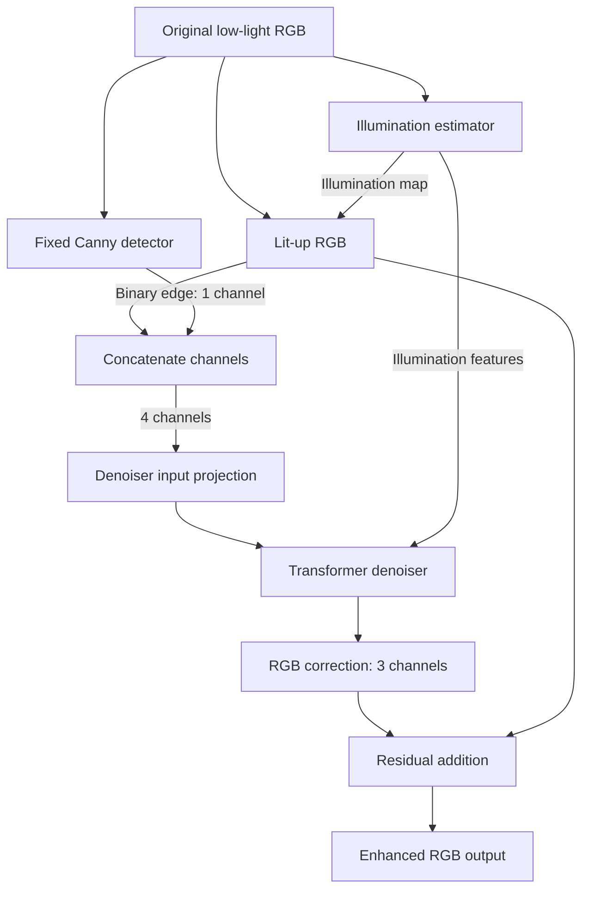

# Supervisor meeting notes — RetinexFormer v1

**ရက်စွဲ:** 10 October 2026  
**အခြေခံ code:** branch `v1`, local commit `6383057`  
**ရည်ရွယ်ချက်:** Low-light image enhancement အတွက် Canny edge guidance ပါသော proposed model နှင့် ပြန်လည်ဆက်လက် train နိုင်သော epoch training workflow ကို ရှင်းပြရန်။

## 1. အစမှာ ပြောနိုင်သော project overview

> “RetinexFormer ရဲ့ illumination estimation နဲ့ transformer denoiser ကို အခြေခံထားပြီး၊ original low-light image က ထုတ်ထားတဲ့ Canny edge map ကို denoiser input မှာ additional channel အဖြစ် ထည့်ထားပါတယ်။ Edge information က object boundaries နဲ့ structure ကို restoration လုပ်ရာမှာ အထောက်အကူဖြစ်နိုင်မလားဆိုတာ လေ့လာဖို့ ဖြစ်ပါတယ်။ Training ကို 200 epochs သတ်မှတ်ပြီး ပထမ 3 epochs မှာ learning-rate warm-up၊ ကျန် epochs မှာ cosine decay သုံးထားပါတယ်။ Seed၊ resume၊ best/last checkpoints၊ metrics logging နဲ့ diagnostic images ထုတ်ပေးတဲ့ workflow ပြည့်စုံအောင် လုပ်ထားပါတယ်။ လက်ရှိ 3-epoch run မှာ loss လျော့ပြီး validation metrics တိုးလာတာ တွေ့ရပေမယ့် final performance နဲ့ Canny ရဲ့ သီးခြားအကျိုးသက်ရောက်မှုကို မသတ်မှတ်ရသေးပါဘူး။”

ဒီ project မှာ အဓိကလုပ်ထားတာ နှစ်ပိုင်းရှိပါတယ်—**model architecture မှာ edge information ထည့်ခြင်း** နဲ့ **စမ်းသပ်မှုကို ပြန်လုပ်နိုင်ပြီး ရလဒ်တွေ စနစ်တကျသိမ်းနိုင်သော training workflow တည်ဆောက်ခြင်း** ဖြစ်ပါတယ်။

## 2. ဘယ် file တွေမှာ ဘာလုပ်ထားသလဲ

အောက်ပါစာရင်းက v1 implementation တစ်ခုလုံးရဲ့ တာဝန်ခွဲခြားချက်ဖြစ်ပါတယ်။ File အားလုံးကို နောက်ဆုံး commit တစ်ခုတည်းမှာ ပြင်ထားသည်ဟု မဆိုလိုပါ။

| File | တာဝန် / ပြောင်းလဲထားသောအချက် |
| --- | --- |
| `canny.py` | Pure-PyTorch Canny edge detector အသစ်။ Low-light input မှ binary edge map ထုတ်ပေးခြင်း။ |
| `RetinexFormer_arch.py` | Edges ကို တစ်ကြိမ်ထုတ်ပြီး stages တွင် ပြန်သုံးခြင်း၊ denoiser input ကို 3 → 4 channels ပြောင်းခြင်း၊ RGB residual ကို သီးခြားပေးခြင်း၊ diagnostics နှင့် explicit baseline checkpoint conversion။ |
| `training_utils.py` | Epoch LR schedule၊ seed၊ fixed split၊ DataLoaders၊ training/validation metrics၊ checkpoint/resume၊ CSV logging နှင့် five-panel visuals။ |
| `Lightweight_RetinexFormer_Colab_Full_Training_v2.ipynb` | Colab မှာ setup → smoke/full training → curves → visuals → final evaluation ကို အစဉ်လိုက် run နိုင်သော workflow။ |
| `analysis_utils.py` | Full-image padding/cropping၊ 8-bit PSNR/SSIM နှင့် image/CSV exports အတွက် shared helpers။ Epoch workflow က ဒီ helpers တွေကို ပြန်သုံးထားခြင်း။ |
| `tests/` | Edge behavior၊ model forward/backward၊ checkpoint compatibility၊ schedule၊ resume၊ metrics နှင့် smoke behavior စစ်ခြင်း။ |
| `V1_CANNY.md`, `EPOCH_TRAINING.md` | Architecture၊ settings၊ loading၊ training အသုံးပြုပုံနှင့် စမ်းသပ်ထားသောအခြေအနေကို မှတ်တမ်းတင်ခြင်း။ |

Notebook ထဲက baseline comparison section ကို ဖယ်ထားပြီး proposed-model workflow ကို အဓိကထားပါတယ်။ Standalone comparison/evaluation scripts တွေကို ဆက်ထားပါတယ်။

## 3. Edge က ဘယ်နေရာမှာ denoiser ထဲဝင်သလဲ



အဆင့်လိုက် ရှင်းလျှင်—

1. **Original low-light RGB** ကို illumination estimator ထဲပေးပြီး illumination map နဲ့ illumination features ထုတ်ပါတယ်။
2. မူလ formula အတိုင်း `lit_up = img * illu_map + img` တွက်ပါတယ်။ ဒီ illumination calculation ကို မပြောင်းထားပါ။
3. Original low-light input ကနေ **Canny edge map** ကို သီးခြားထုတ်ပါတယ်။ Lit-up image ကနေ ထုတ်ခြင်း မဟုတ်ပါ။
4. `torch.cat([lit_up, edge], dim=1)` နဲ့ channel dimension မှာ ပေါင်းပါတယ်။ RGB 3 channels နဲ့ edge 1 channel ဖြစ်လို့ denoiser input က **4 channels** ဖြစ်ပါတယ်။
5. Denoiser က illumination features ကို guidance အဖြစ် ဆက်သုံးပြီး RGB correction ကို ခန့်မှန်းပါတယ်။
6. နောက်ဆုံး `output = mapping(features) + lit_up` ဖြစ်ပါတယ်။ Edge ကို final RGB residual ထဲ တိုက်ရိုက်ပေါင်းခြင်း မရှိပါ။

| Tensor | Shape |
| --- | --- |
| Low-light input | `[B, 3, H, W]` |
| Edge map | `[B, 1, H, W]` |
| Lit-up image | `[B, 3, H, W]` |
| Denoiser input | `[B, 4, H, W]` |
| Enhanced output | `[B, 3, H, W]` |

Transformer feature dimensions၊ illumination estimator၊ output channels နဲ့ L1 loss ကို ဆက်ထိန်းထားပါတယ်။ Notebook configuration က `n_feat=40`, `stage=1`, `num_blocks=[1,2,2]` ဖြစ်ပါတယ်။ ဒီ configuration မှာ edge channel အတွက် trainable weights **360 ခုသာ တိုး**ပြီး total trainable parameters က **1,606,061** ဖြစ်ပါတယ်။

Multi-stage model အသုံးပြုလျှင် edges ကို model call တစ်ကြိမ်အတွက် original input မှ တစ်ကြိမ်သာထုတ်ပြီး stages အားလုံးမှာ ပြန်သုံးပါတယ်။ Notebook ရဲ့ လက်ရှိ experiment က stage တစ်ခုသာ ဖြစ်ပါတယ်။

## 4. Canny က ဘယ်လိုအလုပ်လုပ်သလဲ၊ ဘာကို learn လုပ်သလဲ

| အဆင့် | လက်ရှိ settings / လုပ်ဆောင်ပုံ |
| --- | --- |
| Input preparation | Input ကို detach လုပ်ပြီး copy ကို `[0,1]` ထဲ clamp လုပ်ခြင်း။ Original illumination input ကို ဒီ clamp နဲ့ မပြောင်းပါ။ |
| Grayscale | `0.299 R + 0.587 G + 0.114 B` |
| Smoothing | Gaussian `5×5`, sigma `1.0` |
| Gradient | Unnormalized `3×3` Sobel၊ L2 magnitude |
| Edge thinning | Gradient direction အလိုက် non-maximum suppression |
| Thresholds | Low `0.1`, high `0.2` — Sobel gradient magnitude ပေါ် သတ်မှတ်ထားသော thresholds |
| Connectivity | Strong edges နဲ့ eight-connected ဖြစ်သော weak edges ကို convergence အထိ ဆက်ထိန်းခြင်း၊ မချိတ်ဆက်သော weak edges ကို ဖယ်ခြင်း |
| Output | Binary `0/1` edge map၊ input နဲ့ device/dtype တူခြင်း |

Canny forward ကို float32 နဲ့ autocast ပိတ်ပြီး run ပါတယ်။ NumPy/OpenCV သို့မဟုတ် image tensors ကို CPU ပြောင်းပို့ခြင်း မသုံးပါ။ သို့သော် hysteresis ပြီးပြီလားစစ်တဲ့ convergence scalar က CUDA မှာ host synchronization လိုနိုင်ပါတယ်။ ချိတ်ဆက်နေသော weak-edge chain ရှည်လျှင် အချိန်ပိုယူနိုင်ပါတယ်။

**Canny ကိုယ်တိုင်မှာ learn လုပ်မယ့် parameter မရှိပါ။** Train လုပ်တာက denoiser က edge information ကို ဘယ်လိုအသုံးပြုမလဲဆိုတဲ့ weights ဖြစ်ပါတယ်။ Extra edge-channel weights ကို အစမှာ zero ထားပေမယ့် trainable ဖြစ်ပြီး gradient ရောက်ကြောင်း၊ optimizer update ဖြင့် ပြောင်းလဲကြောင်း tests တွေမှာ စစ်ထားပါတယ်။

Thresholds ကို validation/test results ကြည့်ပြီး tune မလုပ်ထားပါ။ အလွန်မှောင်ပြီး contrast နည်းသော boundaries တွေ လွတ်နိုင်ပါတယ်။ ထို့ကြောင့် sparse edge map ဖြစ်နေတာတစ်ခုတည်းနဲ့ detector ပျက်နေတယ်လို့ မဆိုနိုင်ပါ။

## 5. Iteration approach ကနေ epoch approach သို့

**Iteration** က training batch တစ်ခုအတွက် optimizer update တစ်ကြိမ်ကို ဆိုလိုပါတယ်။ **Epoch** က training subset တစ်ခုလုံးကို တစ်ပတ်ဖြတ်ခြင်း ဖြစ်ပါတယ်။ Epoch approach ပြောင်းသော်လည်း optimizer က batch တိုင်း update လုပ်ဆဲဖြစ်ပြီး LR ကိုသာ epoch အလိုက် သတ်မှတ်ထားပါတယ်။

| Setting | လက်ရှိတန်ဖိုး |
| --- | --- |
| Total epochs | 200 — warm-up 3 epochs အပါအဝင် |
| Warm-up | Epoch 1–3 |
| Epoch 1 LR | `1e-6` |
| Epoch 2 LR | `5.05e-5` |
| Epoch 3 LR | `1e-4` |
| Epoch 4–200 | Cosine decay |
| Epoch 200 LR | `1e-6` |
| Batch size / training patch | `8` / `256×256` |
| Optimizer | Adam၊ betas `(0.9, 0.999)`၊ weight decay `0` |
| Loss | L1 — prediction နဲ့ GT ကြား mean absolute error |
| Precision | Default full precision၊ `USE_AMP=False` |
| Seed | `42` |

Epoch 4 နောက်ပိုင်း schedule က—

```text
progress = (epoch - 3) / 197
LR = 1e-6 + (1e-4 - 1e-6) × (1 + cos(π × progress)) / 2
```

Warm-up ရဲ့ ရည်ရွယ်ချက်က training အစပိုင်းမှာ update size ကို သေးသေးစပြီး peak LR အထိ တဖြည်းဖြည်းတိုးရန် ဖြစ်ပါတယ်။ ဒါက **training warm-up** ဖြစ်ပြီး test images ပထမ 3 ပုံကို run ကြည့်တဲ့ inference warm-up မဟုတ်ပါ။

**200 epochs က စမ်းသပ်မှုအတွက် သတ်မှတ်ထားသော training budget ဖြစ်ပါတယ်။** Test ပုံ 100 ရှိခြင်း၊ LR `1e-4` မှ `1e-6` ဖြစ်ခြင်းတို့ကနေ 200 epochs ကို သင်္ချာနည်းဖြင့် တိုက်ရိုက်တွက်ထုတ်ထားခြင်း မဟုတ်ပါ။ လုံလောက်မှုကို full training ရဲ့ validation curves နဲ့ စစ်ရပါမယ်။

`drop_last=False` ဖြစ်လို့ နောက်ဆုံး batch မှာ 8 ပုံမပြည့်လည်း train ပါတယ်။ `global_step` က batch updates ဘယ်နှကြိမ်ပြီးသွားပြီလဲကို မှတ်တမ်းတင်ခြင်းသာဖြစ်ပြီး LR schedule ကို မထိန်းချုပ်တော့ပါ။

## 6. Training / validation / test ခွဲထားပုံ

Original training filenames တွေကို sort လုပ်ပြီး seed 42 နဲ့ shuffle လုပ်ပါတယ်။ `ceil(0.1 × N)` ကို validation အဖြစ်ယူပြီး ကျန်ပုံတွေကို training အဖြစ်သုံးပါတယ်။ နှစ်ဖက် overlap မရှိစေရန် စစ်ထားပြီး filename lists ကို `split.json` မှာ သိမ်းထားပါတယ်။

| Dataset အပိုင်း | ဘယ်အတွက်သုံးသလဲ | Processing |
| --- | --- | --- |
| Training subset | Weights update လုပ်ရန် | Random crop + augmentation |
| Validation subset | Epoch metrics တွက်ရန်၊ best checkpoint ရွေးရန် | Full images၊ crop/augmentation မလုပ် |
| Official test set | Full training ပြီးသော best model ကို နောက်ဆုံးအကဲဖြတ်ရန် | Full images၊ output images နှင့် metrics export |

Project မှာ final test အတွက် ပုံ 100 ဟု သတ်မှတ်ထားပါတယ်။ Code က actual test folder ထဲက paired images အားလုံးကိုယူပြီး count ကို print ထုတ်ပါတယ်။ Test set ကို training၊ warm-up နဲ့ best-model selection အတွက် မသုံးပါ။

Model က spatial dimensions ကို 4 နဲ့စားပြတ်ရန် လိုသဖြင့် full-image inference မှာ padding ထည့်ပြီး output ကို original size ပြန်ဖြတ်ပါတယ်။ ဒီအချိန် Canny က padded low-light input ပေါ်မှာ အလုပ်လုပ်ပါတယ်။

Reproducibility အတွက် Python၊ NumPy၊ PyTorch၊ CUDA၊ loader generators နဲ့ workers ရဲ့ RNG seeds ကို ထိန်းထားပါတယ်။ Worker persistence နဲ့ cuDNN benchmarking ပိတ်ပြီး deterministic settings သုံးပါတယ်။ Hardware/PyTorch version မတူလျှင် bitwise equality ကို အာမမခံနိုင်ပါ။

## 7. Metrics နဲ့ log frequency

Image enhancement အတွက် classification accuracy မသတ်မှတ်ထားလို့ `train_accu`, `val_accu` အစား **PSNR နဲ့ SSIM** သုံးထားပါတယ်။ PSNR ကို dB နဲ့ဖော်ပြပြီး ပိုမြင့်လေ reconstruction error နည်းလေ ဖြစ်ပါတယ်။ SSIM က image structure ဆင်တူမှုကိုတိုင်းတာပြီး ပိုမြင့်လေ ပိုဆင်တူလေ ဖြစ်ပါတယ်။ L1 loss က ပိုနည်းလေ ပိုကောင်းလေ ဖြစ်ပါတယ်။

| Metrics | တွက်ထားသော data / model state |
| --- | --- |
| `train_loss` | Training batches အားလုံးရဲ့ sample-weighted mean L1 |
| `train_psnr`, `train_ssim` | Augmented training crops ပေါ် batch တစ်ခုချင်းရဲ့ optimizer update မတိုင်မီ prediction မှ per-image mean |
| `val_loss` | Epoch ပြီး model နဲ့ full validation images ရဲ့ mean per-image L1 |
| `val_psnr`, `val_ssim` | Epoch ပြီး model ကို eval mode ထားပြီး full validation images မှ per-image mean |

PSNR/SSIM တွက်ရာမှာ prediction နဲ့ GT ကို clamp၊ round လုပ်၍ saved-image convention အတိုင်း **8-bit RGB pixels** သုံးပါတယ်။ Training L1 ကို original floating-point output ပေါ်မှာ တွက်ပါတယ်။ Train quality metrics အတွက် extra model forward မလုပ်ပေမယ့် CPU pixel conversion နဲ့ SSIM computation အချိန်တော့ ထပ်ကုန်ပါတယ်။

Train/validation curves တွေဟာ crops/full images၊ augmentation နဲ့ model state ကွာသဖြင့် တိုက်ရိုက်တူညီသော conditions မဟုတ်ပါ။ Accuracy percentages လို့ မဖော်ပြပါ။

CSV/console က **3 epochs တစ်ကြိမ်** ထုတ်ပါတယ်—full run မှာ `3, 6, …, 198, 200`၊ စုစုပေါင်း **67 rows** ဖြစ်ပါတယ်။ Row တစ်ခုက အဲဒီ epoch ရဲ့ metrics ဖြစ်ပြီး သုံး epoch ပေါင်း average မဟုတ်ပါ။ Validation နဲ့ checkpoint updates ကတော့ epoch တိုင်းလုပ်ဆဲဖြစ်ပါတယ်။ Checkpoint history မှာလည်း epoch တိုင်းရဲ့ records ရှိပါတယ်။

CSV fields: `epoch`, `global_step`, `train_loss`, `val_loss`, `train_psnr`, `val_psnr`, `train_ssim`, `val_ssim`, `lr`, `epoch_seconds`, `elapsed_seconds`, `is_best`။

အဟောင်း checkpoint ကနေ resume လုပ်လျှင် အရင်က မတွက်ထားသော training PSNR/SSIM တွေကို blank ထားပါတယ်။ အဲဒီ scores တွေကို last model တစ်ခုတည်းကနေ အတိတ်အတွက် ပြန်ဖန်တီးမထားပါ။

## 8. Best / last checkpoints နဲ့ resume

- **`last.pth`** — နောက်ဆုံးပြီးဆုံးသွားသော epoch ရဲ့ state ကို epoch တိုင်း update လုပ်ပါတယ်။ Training ပြန်ဆက်ရန် သုံးပါတယ်။
- **`best.pth`** — validation PSNR က ယခင်အကောင်းဆုံးထက် strictly ပိုမြင့်မှ update လုပ်ပါတယ်။ တူလျှင် အဟောင်း best ကို ဆက်ထားပါတယ်။ အဲဒီ best epoch နဲ့ SSIM ကိုပါ မှတ်ထားပါတယ်။

Checkpoint နှစ်ခုလုံးမှာ model၊ optimizer၊ scheduler၊ scaler၊ completed epoch၊ global step၊ best metrics၊ config၊ split၊ metric history နဲ့ RNG/loader-generator states ပါပါတယ်။ Temporary file ရေးပြီး replace လုပ်တဲ့နည်းနဲ့ သိမ်းပါတယ်။

Resume လုပ်တဲ့အခါ `last.pth` ရဲ့ completed epoch နောက်တစ်ခုကနေ ဆက်ပါတယ်။ Epoch အလယ်မှာပြတ်လျှင် မပြီးသေးတဲ့ epoch ကို ပြန် run ပါတယ်။ Config/split မကိုက်ခြင်းနဲ့ old iteration checkpoints ကို ရှင်းလင်းသော error ဖြင့် ပယ်ပါတယ်။ CSV ကို checkpoint history ကနေ ပြန်တည်ဆောက်လို့ duplicate/stale rows မကျန်စေပါ။

Baseline weights ကို v1 မှာ သုံးလိုပါက `load_baseline_state_dict(...)` နဲ့ explicit conversion လုပ်ရပါတယ်။ RGB input weights ကိုကူးပြီး edge channel ကို zero ထည့်ခြင်းသာပြောင်းကာ အခြား mismatches ကို ပယ်ပါတယ်။ ပုံမှန် strict loading က baseline weights ကို တိတ်တဆ မပြောင်းပေးပါ။ **လက်ရှိ proposed full experiment က scratch training ဖြစ်ပါတယ်။**

## 9. Smoke နဲ့ full training ကို ဘယ်လိုသုံးသလဲ

| Mode | လုပ်ဆောင်ချက် | Output folder |
| --- | --- | --- |
| `RUN_MODE="smoke"` | 200-epoch schedule ရဲ့ ပထမ 3 warm-up epochs ကို run ပြီး ရပ်ခြင်း | `Lightweight_RetinexFormer_v1_LOLv2_real_Epoch200_Smoke3` |
| `RUN_MODE="full"` | Configured 200 epochs အထိ train ခြင်း | `Lightweight_RetinexFormer_v1_LOLv2_real_Epoch200` |

Default က smoke ဖြစ်ပါတယ်။ Notebook မှာ Smoke training နဲ့ Full training cell နှစ်ခုရှိပြီး ရွေးထားသော mode တစ်ခုသာ အလုပ်လုပ်ပါတယ်။ Smoke mode နဲ့ Run all သုံးလျှင် training က epoch 3 မှာရပ်ပြီး official-test evaluation ကို skip လုပ်ပါတယ်။

Smoke ရလဒ်ကြည့်ပြီး fresh full run စရန် `RUN_MODE="full"`, `RESUME_FROM=None` ထား၍ configuration → split → model setup → full training ကို ပြန် run ရပါမယ်။ Model၊ optimizer နဲ့ loader state အသစ်စပြီး smoke weights ကို ဆက်မသုံးပါ။ ရှိပြီးသား experiment ကို fresh run နဲ့ overwrite မလုပ်စေရန် check ပါပါတယ်။

## 10. ဘာ results / artifacts တွေ ထုတ်ပေးသလဲ

| Artifact | Supervisor ကို ဘာပြနိုင်သလဲ |
| --- | --- |
| `config.json` | Architecture၊ Canny settings၊ seed၊ optimizer နဲ့ schedule အတိအကျ |
| `split.json` | Training/validation filenames နှင့် overlap မရှိသော split |
| `checkpoints/best.pth` | Validation PSNR အကောင်းဆုံး model နှင့် training state |
| `checkpoints/last.pth` | နောက်ဆုံး training progress နှင့် resume state |
| `logs/training_metrics.csv` | Training/validation metrics၊ LR၊ timing၊ best flags |
| `logs/training_curves.png` | L1၊ PSNR၊ SSIM၊ LR curves |
| `visuals/epoch_XXXX/` | Low / Edge / Lit-up / Output / GT ကို panel အလိုက်နှင့် grid အဖြစ် သိမ်းထားသောပုံများ |
| `final_test_outputs/` | Full training ပြီးမှ ထုတ်မည့် Low / Output / GT images နှင့် `per_image_metrics.csv`; CSV အဆုံးမှာ mean PSNR/SSIM ပါသော `AVERAGE` row |

Visuals အတွက် validation ပုံ 5 ပုံကို fixed selection ထားပါတယ်။ Validation ပုံ 5 ပုံထက်နည်းသော synthetic test မှာ ရှိသမျှသာသုံးပါတယ်။ Full run မှာ epoch 1၊ 10 epochs တိုင်းနဲ့ final epoch; smoke မှာ epoch 1 နဲ့ 3 ပုံတွေ သိမ်းပါတယ်။

Panels ဖတ်ပုံက **Low** = input၊ **Edge** = extracted structure၊ **Lit-up** = illumination adjustment အပြီး intermediate image၊ **Output** = denoiser correction ပေါင်းပြီး result၊ **GT** = target image ဖြစ်ပါတယ်။ Lit-up နဲ့ output ကို ကြည့်ခြင်းဖြင့် illumination အပိုင်းနဲ့ restoration အပိုင်းရဲ့ output ကို သီးခြားစစ်နိုင်ပါတယ်။

## 11. လက်ရှိ လက်တွေ့ရထားသော results

### A. User ပေးထားသော 3-epoch run screenshot

အောက်ပါနံပါတ်တွေက user ပေးထားသော `training_metrics.csv` screenshot မှ round လုပ်ကူးထားခြင်းဖြစ်ပါတယ်။ Raw CSV/checkpoint ကို ဒီ notes အတွက် ထပ်မံစစ်ဆေးထားခြင်း မရှိပါ။ **Validation results ဖြစ်ပြီး official-test results မဟုတ်ပါ။**

| Epoch | Global step | LR | Train L1 ↓ | Validation L1 ↓ | Validation PSNR ↑ | Validation SSIM ↑ |
| --- | --- | --- | --- | --- | --- | --- |
| 1 | 78 | `1e-6` | 0.406478 | 0.396853 | 7.4058 dB | 0.1236 |
| 2 | 156 | `5.05e-5` | 0.207958 | 0.143377 | 15.6039 dB | 0.5324 |
| 3 | 234 | `1e-4` | 0.133190 | 0.105649 | 18.4683 dB | 0.5788 |

ဒီ 3 epochs အတွင်း training/validation L1 လျော့ပြီး validation PSNR/SSIM တိုးလာပါတယ်။ စောစောပိုင်း training မှာ model က target images နဲ့ ပိုနီးလာကြောင်း ပြပါတယ်။ Screenshot မှာ `is_best=True` သုံးခုလုံးဖြစ်ရတာက **epoch တစ်ခုချင်းစီဟာ အဲဒီအချိန်အထိ PSNR record အသစ် ဖြစ်ခဲ့လို့ပါ**။ Epoch 3 အဆုံးမှာ best checkpoint က epoch 3 ဖြစ်ပါတယ်။ အရင် rows ရဲ့ historical best flags ကို False ပြန်မပြောင်းပါ။

ဒီ screenshot က logging/metric update မတိုင်မီ run ဖြစ်လို့ epoch 1, 2, 3 rows ပါပြီး training PSNR/SSIM မပါသေးပါ။ လက်ရှိ notebook ရဲ့ fresh smoke run မှာ CSV row က epoch 3 တစ်ကြောင်းဖြစ်ပြီး training PSNR/SSIM ပါလာပါမယ်။ အဟောင်း training scores ကို ဒီ notes မှာ ခန့်မှန်းမထည့်ထားပါ။

### B. Implementation correctness စစ်ထားခြင်း

- Canny/analysis tests တွေမှာ constant/blank/step/diagonal inputs၊ thinning၊ weak-edge connectivity၊ long-chain hysteresis၊ tensor shape/dtype/device တို့ကို စစ်ထားပါတယ်။
- RGB residual identity၊ model forward/L1/backward၊ edge-channel gradient/update၊ multi-stage edge reuse၊ checkpoint conversion/round-trip နဲ့ padded image exports ကို စစ်ထားပါတယ်။
- Epoch workflow မှာ LR boundaries၊ data split၊ sample weighting၊ best/last selection၊ invalid resume၊ CSV recovery နဲ့ uninterrupted/save-resume equivalence ကို စစ်ထားပါတယ်။
- Logging/metrics update ပြီးချိန် full suite မှာ **30 tests run: 28 passed, 2 CUDA tests skipped** ဖြစ်ပါတယ်။
- နောက်ဆုံး smoke/full mode update အတွက် **single-process epoch tests 13 ခုလုံး passed** ဖြစ်ပါတယ်။ ဒီ 13 ခုကို အပေါ်က 28 ခုနဲ့ ပေါင်းပြီး unique tests အရေအတွက်အဖြစ် မရေတွက်ပါ။
- Actual notebook cells ကို full v1 architecture နဲ့ synthetic data ပေါ် run ပြီး smoke 3 epochs၊ အတိုချုံ့ထားသော full-mode 4 epochs၊ fresh-model reset၊ folder isolation၊ plots၊ visuals နဲ့ final export လမ်းကြောင်းတို့ အလုပ်လုပ်ကြောင်း စစ်ထားပါတယ်။ Synthetic scores ကို LOLv2 experiment performance အဖြစ် မသုံးပါ။

Local automated verification က CPU ပေါ်မှာ ဖြစ်ပါတယ်။ CUDA training/mixed-precision tests နဲ့ GPU timing ကို local မှာ မအတည်ပြုနိုင်သေးပါ။ Screenshot ရဲ့ runtime hardware ကို ဒီ notes က မခန့်မှန်းထားပါ။

## 12. လက်ရှိ ဘာကိုပြောနိုင်ပြီး ဘာကို ဆက်စစ်ရမလဲ

**ပြောနိုင်သောအချက်:** Proposed architecture၊ training/resume workflow နဲ့ result exports တည်ဆောက်ပြီးဖြစ်ပါတယ်။ CPU functional checks အောင်မြင်ပြီး user ပေးထားသော 3-epoch run မှာ loss/validation metrics အစောပိုင်း တိုးတက်မှု တွေ့ရပါတယ်။

**မသတ်မှတ်ရသေးသောအချက်:** 200-epoch full experiment ရဲ့ final test PSNR/SSIM ကို ဒီ conversation မှာ မရရှိသေးပါ။ လက်ရှိ 3-epoch result က warm-up အတွင်းရလဒ်သာ ဖြစ်ပါတယ်။ Model တစ်ခုအတွင်း epoch 1 → 3 တိုးတက်မှုကို “Canny ထည့်လို့ baseline ထက်ပိုကောင်းတယ်” ဟု မသတ်မှတ်နိုင်ပါ။

လက်ရှိရည်ရွယ်ချက်အတိုင်း proposed model ကို train ပြီး final test results report လုပ်နိုင်ပါတယ်။ နောင် Canny ရဲ့ သီးခြား contribution ကို ပြောလိုမှသာ data split၊ training budget၊ seed နဲ့ evaluation protocol ကိုတူအောင်ထားသော edge-on/edge-off ablation လိုပါမယ်။ လက်ရှိ notebook မှာ အဲဒီ comparison ကို မလုပ်ထားပါ။

နောက်လုပ်ရန် အဆင့်တွေက full 200-epoch run → validation curves/best epoch စစ်ခြင်း → best checkpoint နဲ့ official test set အားလုံး evaluate ခြင်း → mean/per-image PSNR/SSIM နဲ့ representative output/failure examples ကိုတင်ပြခြင်း ဖြစ်ပါတယ်။

## 13. Meeting မှာ ပြရန် အစဉ်

1. Architecture diagram နဲ့ “edge ကို denoiser input မှာ channel အဖြစ်ထည့်ထားခြင်း” ကို ရှင်းပြပါ။
2. 200 epochs၊ 3 warm-up၊ LR schedule နဲ့ training/validation/test ခွဲထားပုံကို ပြပါ။
3. 3-epoch screenshot table နဲ့ metrics တိုးတက်ပုံ၊ historical best flag အဓိပ္ပာယ်ကို ပြပါ။
4. တူညီသော validation image ရဲ့ epoch 1 နဲ့ epoch 3 five-panel grids ကို ကြည့်ပါ။
5. Implementation checks ပြီးစီးမှု၊ full-run results မရရှိသေးမှုနဲ့ နောက်စမ်းသပ်မည့်အစီအစဉ်ကို ရှင်းပြပါ။

**ရှင်းလင်းပြောနိုင်သော စာကြောင်း:** “လက်ရှိအဆင့်က proposed model implementation နဲ့ training workflow ကို အလုပ်ဖြစ်ကြောင်းစစ်ပြီး early training improvement တွေ့ထားတဲ့အဆင့်ပါ။ Final performance ကို full training ပြီး best checkpoint ရဲ့ held-out test evaluation နဲ့ report လုပ်ပါမယ်။”

---

Code reference: [Architecture](/Users/apwiz/msc/thesis/myRetinexformer/RetinexFormer_arch.py), [Canny](/Users/apwiz/msc/thesis/myRetinexformer/canny.py), [Training helpers](/Users/apwiz/msc/thesis/myRetinexformer/training_utils.py), [Colab notebook](/Users/apwiz/msc/thesis/myRetinexformer/Lightweight_RetinexFormer_Colab_Full_Training_v2.ipynb).
